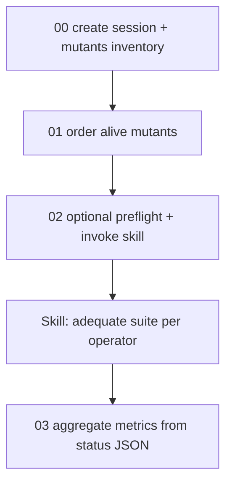

# Mutation-operator adequate test sets

## Feasibility

Yes. Existing pieces already compose the loop:

- Alive IDs: `mutants/<OP>.txt` from `scripts/00-create-test-session.sh` / `scripts/01-ordering-alive-mutants.sh`
- Operator activation: `exemuta -select -all 0.0 -<OP> 1.0 S_<PROG>`
- Mutant inspection: `exemuta -build-view -x <id> S_<PROG>`
- CUnit data layout: `ts_data/test_cases_<function>.csv` + `--data <dir> <function> <n>`
- Import / exec / status: `tcase -add`, `exemuta -exec -trace`, `muta -l -f <id> -t <id>`

The skill orchestrates this; the LLM invents killing tests from build-view diffs. Small Python helpers keep JSON and alive-lists consistent.

## Confirmed decisions

| Decision | Choice |
|----------|--------|
| Status storage | **One JSON per operator**: `mutants/<OP_ACRONYM>_execution_status.json` |
| Skill location | **Project**: `.cursor/skills/mutation-operator-adequate-test-set/` |
| Equivalent threshold | **`max_iterations` default 5**; documented how to override |

## Remaining experiment pipeline



1. `00` / `01` — done
2. **Skill (+ helpers + docs)** — this work
3. Later: aggregate MS / time / tokens / cost across programs

## Skill package

Create `.cursor/skills/mutation-operator-adequate-test-set/`:

- `SKILL.md` — when to use; prerequisites (`PROTEUMIMHOME`, session from `00`, ordered lists from `01`); full loop; Proteum and CUnit commands verbatim; status schema; collateral-kill rules; how to set `max_iterations`
- `reference.md` — CSV/`testset_<OP>.txt` conventions, example `muta -l` status parsing, JSON schema
- `scripts/` (helpers called by the agent):
  - `update_execution_status.py` — create/merge mutant records in `mutants/<OP>_execution_status.json`
  - `sync_alive_list.py` — remove IDs from `mutants/<OP>.txt` after KILLED/EQUIVALENT
  - `parse_muta_status.py` — parse `muta -l -f/-t` for Alive/Dead
  - `append_csv_case.py` — append a row to `ts_<OP>/test_cases_<function>.csv` and return next `test_number`

Also update `scripts/README.md` with how to invoke the skill and the `max_iterations` knob.

## Parameterization (aligned with existing scripts)

```text
--programs-dir <path>
--programs-file <path>
--operators-list <path>          # default scripts/unit-operators-list.txt
--max-iterations <int>           # default 5
--llm-name <str>                 # recorded into JSON (caller-supplied)
```

**Changing `max_iterations`:** pass `--max-iterations N` when starting the skill run, or state it in the user prompt (e.g. “use max_iterations=10”). Default remains **5** if omitted. Document both in `SKILL.md` and `scripts/README.md`.

## Core algorithm

For each operator `OP` in `--operators-list`, for each program `P` in `--programs-file`:

1. `cd $programs_dir/$P`; require `S_$P.*`, `runner`, `runner_instr`, `mutants/$OP.txt`.
2. Ensure `ts_$OP/` exists; seed CSV headers from `ts_data/test_cases_*.csv` when creating files; ensure `testset_$OP.txt` exists.
3. Init/load `mutants/${OP}_execution_status.json`.
4. `exemuta -select -all 0.0 -$OP 1.0 S_$P`
5. While `mutants/$OP.txt` non-empty:
   - `target` = first ID (list already ordered by `01`)
   - Record `initial_time`; `exemuta -build-view -x $target S_$P`
   - Iterate up to `max_iterations`:
     - Propose TC for a known CUnit function (CSV columns match that function’s schema)
     - Validate: `./runner --data ts_$OP <function> <n>` **must succeed**
     - Append CSV + `function n` to `testset_$OP.txt`
     - `tcase -add -trace -E runner -EE runner_instr -p "--data ts_$OP <function> <n>" S_$P`
     - `exemuta -exec -trace S_$P`
     - For every ID still in `mutants/$OP.txt`, `muta -l -f ID -t ID S_$P`:
       - Dead → `KILLED`; collateral kills set `killed_by_mutant_target` to target; remove from alive list
     - If target killed → break
   - If target still alive after `max_iterations` → `EQUIVALENT` (possible); remove from alive list
6. Next program; then next operator.

Never remove IDs from the alive file until the status JSON is updated.

## Status JSON schema

`mutants/<OP>_execution_status.json`:

```json
{
  "program": "boundedQueue",
  "operator": "u-CCDL",
  "session": "S_boundedQueue",
  "max_iterations": 5,
  "llm_name": "caller-supplied",
  "mutants": [
    {
      "mutant_number": 0,
      "status": "KILLED",
      "function_under_testing": "createQueue",
      "test_case_number": 4,
      "killed_by_mutant_target": null,
      "rationality": "…",
      "initial_time": "2026-10-17T20:00:00+01:00",
      "end_time": "2026-10-17T20:02:10+01:00",
      "number_of_iterations": 2,
      "tokens": { "input": 0, "output": 0 },
      "cost_usd": { "input": 0.0, "output": 0.0, "total": 0.0 }
    }
  ]
}
```

`status ∈ {KILLED, EQUIVALENT, ALIVE, UNKNOWN}`.

## Artifacts per program/operator

| Path | Role |
|------|------|
| `ts_<OP>/test_cases_<function>.csv` | Same schema as `ts_data` |
| `testset_<OP>.txt` | Lines `<function> <test_number>` |
| `mutants/<OP>.txt` | Remaining alive IDs only |
| `mutants/<OP>_execution_status.json` | Full traceability |

## Implementation order

1. Author skill `SKILL.md` + `reference.md`
2. Add helper scripts under the skill’s `scripts/`
3. Document in `scripts/README.md`
4. Pilot on `boundedQueue` + one small operator (e.g. `u-CCDL`) before full runs

## Out of scope for this step

- Full overnight run for all operators × all programs
- Aggregate paper tables (`03`)
- Guaranteeing exact LLM token billing under Auto mode
